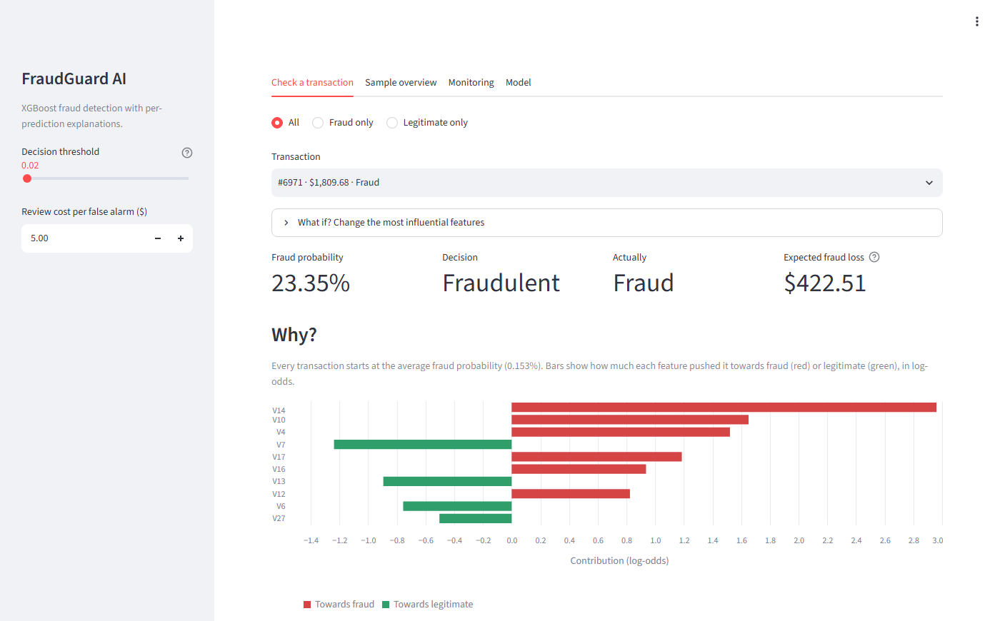
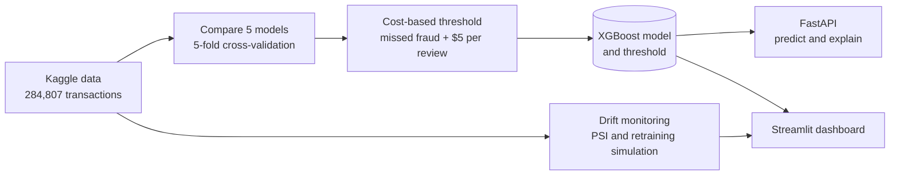

# FraudGuard AI

[](https://github.com/nithisha205/fraudguard-ai/actions/workflows/tests.yml)

[](LICENSE)
[](https://fraudguard-dashboard-f28d.onrender.com)

Credit card fraud detection that decides by **cost in dollars**, **explains every prediction**, and **monitors itself for drift**.

**Live demo:** [dashboard](https://fraudguard-dashboard-f28d.onrender.com) · [API docs](https://fraudguard-api-dj2k.onrender.com/docs)
(free hosting: the first visit after a quiet spell can take up to a minute while the service wakes up)



*The dashboard opens on the largest fraud the model catches. The model is only 23% sure, but that is far above the
cost-based threshold of 2%, so the $1,809.68 transaction is flagged: a $5 review is cheap compared with the money at stake.
Red bars push towards fraud, green towards legitimate.*

## Key findings

- **Judged in money, not accuracy.** XGBoost with a cost-based threshold catches 85 of 98 test frauds and cuts
  missed fraud plus review costs by 5% compared with the Random Forest baseline ($2,078 → $1,981).
- **A random split flatters the model.** Trained on the past and tested on later transactions, average precision drops from 0.87 to 0.80.
- **Retraining pays off, and drift shows before labels do.** Retraining every 8 hours on all data so far cuts cost by 8%;
  a drift alarm comparing each block with the same hours a day earlier flagged exactly the blocks where the old model fell behind.
- **Some fraud is invisible.** 53 frauds (about $12,000) look completely normal to every model tried; catching them needs new data, not a new model.
- **Negative results are reported too.** Hour-of-day features, flagging by expected loss and up-weighting fraud did not help.

Full tables and charts: [reports/results.md](reports/results.md).

## How it works



1. **Split** — stratified 60% train / 20% validation / 20% test (`src/fraudguard/data.py`). The test set is used once, at the end.
2. **Compare models** — Logistic Regression, Random Forest, LightGBM, XGBoost and calibrated XGBoost with 5-fold cross-validation (`scripts/compare_models.py`).
3. **Choose the threshold by cost** — `scripts/evaluate_final_model.py` keeps the threshold with the lowest `missed fraud amount + $5 × false alarms`
   on out-of-fold predictions, trains the final model, and evaluates it once on the test set against the Random Forest baseline.
4. **Explain** — `src/fraudguard/explain.py` uses XGBoost's built-in TreeSHAP. The base value plus all contributions reproduces the prediction exactly (checked in the tests).
5. **Monitor** — `scripts/monitoring.py` measures drift with the Population Stability Index and replays the data to compare retraining strategies.

## Results

Held-out test set: 56,962 transactions, 98 fraud worth $10,644.93 in total.

| Model | Threshold | Avg. precision | ROC-AUC | Fraud caught | False alarms | Total cost* |
|---|---:|---:|---:|---:|---:|---:|
| Random Forest (baseline) | 0.44 | 0.8603 | 0.9623 | 82 / 98 | 11 | $2,077.77 |
| **XGBoost (final)** | **0.02** | **0.8722** | **0.9757** | **85 / 98** | 30 | **$1,980.72** |

\* Total cost = amount of fraud missed + $5 review cost for every false alarm.
Accuracy is not used: predicting "legitimate" for everything already scores 99.83%.

More in [reports/results.md](reports/results.md): the model comparison, the time-based split, drift monitoring and retraining, and what the model still misses.

## Quick start

The dataset is not needed to run the app: the trained model and a sample of 298 test transactions are included.

### With Docker

```bash
docker compose up --build
```

- API: http://localhost:8000/docs
- Dashboard: http://localhost:8501

### With Python

```bash
pip install -r requirements.txt
pip install -e .
uvicorn fraudguard.api:app --reload
streamlit run src/fraudguard/dashboard.py
```

## Dashboard

`src/fraudguard/dashboard.py` has four tabs:

- **Check a transaction** — pick any of the 298 held-out test transactions (all 98 test frauds plus 200 legitimate ones),
  see the fraud probability, the decision, the true label and a chart of the features behind the decision.
  "What if?" lets you change the most influential features and watch the probability move.
- **Sample overview** — fraud caught, money missed, false alarms and total cost for the sample; move the threshold and review cost in the sidebar to see the trade-off.
- **Monitoring** — drift status per 8-hour block and the cost of never retraining vs retraining.
- **Model** — test metrics, how the threshold was chosen, and the cost curve.

## API

### Example

A real fraudulent transaction from the test set:

```bash
curl -X POST http://127.0.0.1:8000/predict -H "Content-Type: application/json" -d @transaction.json
```

```json
{
  "fraud_probability": 0.900464,
  "threshold": 0.02,
  "prediction": "Fraudulent",
  "base_probability": 0.001533,
  "top_factors": [
    {"feature": "V10", "value": -9.2228, "contribution": 5.1232},
    {"feature": "V14", "value": -9.8251, "contribution": 2.6112},
    {"feature": "V4",  "value": 6.0173,  "contribution": 1.5446}
  ]
}
```

The response is cut to three factors here; the API returns five.
The request body must contain exactly the 30 model features (`Time`, `V1`–`V28`, `Amount`) as numbers; anything else returns `422`.

| Endpoint | Purpose |
|---|---|
| `GET /` | API status |
| `GET /health` | Model type, threshold, how it was chosen, and test metrics |
| `POST /predict` | Fraud probability, prediction and top 5 contributing features |

## Retraining

1. Download `creditcard.csv` from the [Kaggle Credit Card Fraud Detection dataset](https://www.kaggle.com/datasets/mlg-ulb/creditcardfraud) (ULB Machine Learning Group) into `data/`.
2. Install the project once with `pip install -r requirements.txt` and `pip install -e .`, then run the scripts from the project root:

```bash
python scripts/inspect_data.py               # dataset overview
python scripts/explore_data.py               # charts in reports/figures/
python scripts/compare_models.py             # cross-validated model comparison (about 5 minutes)
python experiments/feature_experiment.py     # hour-of-day feature experiment
python experiments/time_split_evaluation.py  # random vs time-based split
python scripts/monitoring.py                 # drift report and retraining simulation
python scripts/evaluate_final_model.py       # cost-based threshold, final test, saves the model
python scripts/make_samples.py               # dashboard sample transactions
```

## Deploying

`render.yaml` deploys the dashboard and the API to [Render](https://render.com)'s free plan from this repository:
in Render choose **New → Blueprint**, connect the GitHub repository and click **Apply**.
Each service uses about 150–200 MB of memory, within the free plan's 512 MB.
Free services sleep after 15 minutes without visitors, so the first visit afterwards takes about a minute.

## Tests and linting

```bash
pytest
ruff check .
ruff format --check .
```

## Project structure

```text
src/fraudguard/              the installable package used by the API and dashboard
  data.py                    loading, split, models, cross-validation and cost
  explain.py                 per-prediction feature contributions (TreeSHAP)
  predictor.py               loads the model; scores and explains one transaction
  drift.py                   Population Stability Index (PSI) drift checks
  api.py                     FastAPI service
  dashboard.py               Streamlit dashboard
scripts/                     the main pipeline: explore, compare, train and evaluate, monitor, make samples
experiments/                 one-off studies (time split, hour features) and the earlier baseline scripts
tests/                       API, explanation, cost, drift and dashboard tests
samples/                     298 held-out test transactions for the dashboard
reports/                     detailed results, EDA notes, baseline evaluation, figures
docs/                        README screenshot
models/fraud_model.joblib    trained model, threshold, feature list and test metrics
Dockerfile, docker-compose.yml, requirements-app.txt   container for the API and dashboard
pyproject.toml               package, pytest and ruff settings
```

## Limitations

- Features `V1`–`V28` are PCA-anonymised, so explanations name components rather than real-world attributes.
- Results drop on later transactions (see the time-based split); the reported test results come from a random split.
- The $5 review cost is an assumption; a real team would plug in its own costs.
- Not validated for use in a real payment system.

## Data

[Credit Card Fraud Detection](https://www.kaggle.com/datasets/mlg-ulb/creditcardfraud) by the Machine Learning Group of Université Libre de Bruxelles (ULB),
released under the Open Database License. `samples/sample_transactions.csv` is a 298-row extract of it.

## License

The code is released under the [MIT License](LICENSE). The dataset keeps its own license (see Data above).
