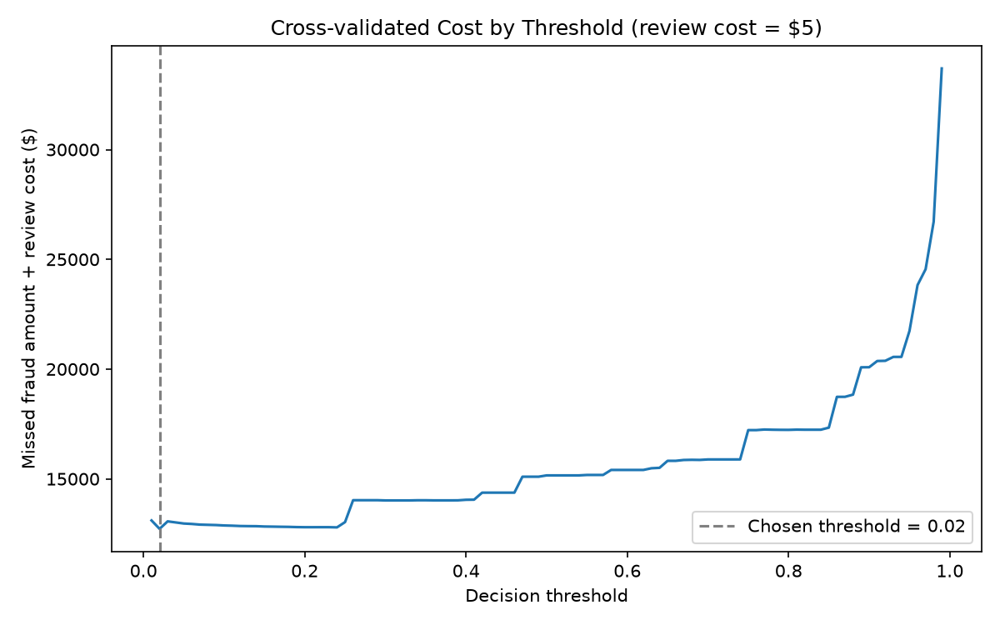
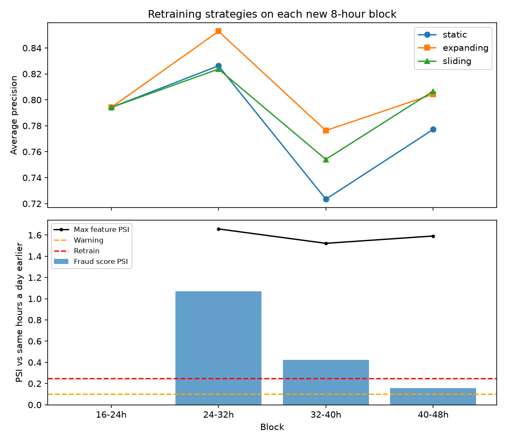

# FraudGuard AI — Detailed Results

Back to the [README](../README.md). All numbers come from the scripts named in each section, run on the full Kaggle dataset.

## Cost-based threshold

The threshold is low because XGBoost (trained without class weighting) gives realistic probabilities: the base fraud rate is about 0.15%,
so a 2% chance of fraud is already 13 times the average. The cost curve is nearly flat from 0.02 to 0.24, so the exact choice in that range matters little.

## Model comparison

5-fold cross-validation on the training + validation data (227,845 transactions, 394 fraud), produced by `scripts/compare_models.py`:

| Model | Avg. precision | Brier score | Best threshold | Cost | Missed fraud | False alarms | Cost with expected-loss rule |
|---|---:|---:|---:|---:|---:|---:|---:|
| Logistic Regression | 0.7478 | 0.02303 | 0.99 | $13,571 | 70 | 213 | $193,939 |
| Random Forest | 0.8352 | 0.00045 | 0.20 | $12,789 | 64 | 79 | $12,929 |
| LightGBM | 0.8402 | 0.00046 | 0.03 | $13,224 | 76 | 31 | $13,390 |
| **XGBoost** | **0.8525** | **0.00040** | 0.02 | $12,723 | 62 | 100 | $12,862 |
| XGBoost + isotonic calibration | 0.8488 | 0.00040 | 0.04 | $12,658 | 60 | 136 | $12,527 |

Total fraud in these transactions: $49,483. Best thresholds are picked on the same predictions they are scored on, so these costs are slightly optimistic.
XGBoost has the best average precision and the most accurate probabilities (lowest Brier score), so it was chosen.
Logistic Regression's huge expected-loss cost shows why that rule needs realistic probabilities: `class_weight="balanced"` inflates them, so it flags almost everything.

## Does it work on future transactions?

The random split mixes transactions from the whole 48 hours, so the model is tested on the same period it learned from.
`experiments/time_split_evaluation.py` instead trains on the first 60% of transactions in time, picks the threshold on the next 20%, and tests on the last 20% (hours 40–48):

| Split | Avg. precision | ROC-AUC | Fraud caught | False alarms | Cost / total fraud |
|---|---:|---:|---:|---:|---:|
| Random (stratified) | 0.8710 | 0.9752 | 82 / 98 (84%) | 7 | $1,968 / $10,645 (18%) |
| Time-based (past → future) | 0.7993 | 0.9793 | 57 / 75 (76%) | 11 | $2,693 / $7,729 (35%) |

Average precision drops from 0.87 to 0.80 and the share of fraud money lost doubles, so **the random-split numbers are optimistic**.
Fraud patterns shift even within two days; a real deployment would need regular retraining and monitoring.
(Both rows use a single 60/20/20 split without cross-validation, so they differ slightly from the final model's results above.)

## Monitoring drift and retraining

If the model gets worse over time, when should it be retrained? `scripts/monitoring.py` replays the 48 hours in 8-hour blocks.
A model trained on the first 16 hours and never updated (**static**) is compared with retraining before every block on all data so far (**expanding**)
or on the latest 16 hours only (**sliding**). All use the saved threshold of 0.02.

| Hours | Fraud | Drift status | Score PSI | Static avg precision | Expanding avg precision |
|---|---:|---|---:|---:|---:|
| 16–24 | 90 | no earlier day | – | 0.794 | 0.794 |
| 24–32 | 75 | retrain | 1.07 | 0.826 | 0.853 |
| 32–40 | 59 | retrain | 0.42 | 0.723 | 0.776 |
| 40–48 | 77 | warning | 0.16 | 0.777 | 0.804 |

| Strategy | Total cost | Fraud caught |
|---|---:|---:|
| Static (never retrained) | $12,846 | 82.7% |
| **Expanding (all data so far)** | **$11,834** | 82.4% |
| Sliding (latest 16 hours) | $12,013 | 81.4% |

- **Retraining pays off:** expanding retraining wins in every block after the first day and cuts total cost by about 8% ($1,012).
  Keeping all past data beats a short sliding window, because fraud is rare and every example counts.
- **Drift can be seen before labels arrive.** The Population Stability Index (PSI) compares each block with the same hours one day earlier,
  without needing to know which transactions were fraud. The fraud-score PSI flagged exactly the blocks where the static model fell behind.
- **Compare like with like.** Comparing night-time transactions with a mix of day and night raised false alarms on almost every feature
  (V12: PSI 0.81 against the first 16 hours, but 0.003 against the previous night). With a same-time-of-day reference, only a real shift on day 2 remains,
  led by `V1`, `V3` and `V28`.

PSI rule of thumb: below 0.10 OK, 0.10–0.25 warning, above 0.25 retrain. With only two days of data this is a simulation, not proof;
a real system would watch weeks of data and retrain on a schedule as well as on alerts.

## What the model still misses

The 13 missed test frauds ($1,830.72) have a median predicted fraud probability below 0.01%: to the model they look completely normal.
In cross-validation, 53 frauds (about $12,000) were missed by *every* model, even at a 5% threshold.
Since features `V1`–`V28` are anonymised PCA components, catching these would need new information such as cardholder history,
merchant or transaction velocity, not a different model or threshold.

Three ideas that did **not** help, kept here because negative results are results too:

- **Hour-of-day features** (`experiments/feature_experiment.py`): fraud is up to 10× more common in some hours, but adding the hour (also as a 24-hour circle) left cross-validated average precision unchanged (0.8529 vs 0.8525) and did not lower cost. The model already gets this from `Time` and the V features.
- **Flagging by expected loss** (`probability × amount > $5`) instead of one threshold lets many small frauds through and was not cheaper, even with isotonic calibration (about 2% better, within noise).
- **Up-weighting fraud** (`scale_pos_weight=10`) did not improve average precision on the validation set for XGBoost, and hurt LightGBM badly (0.83 → 0.56).
